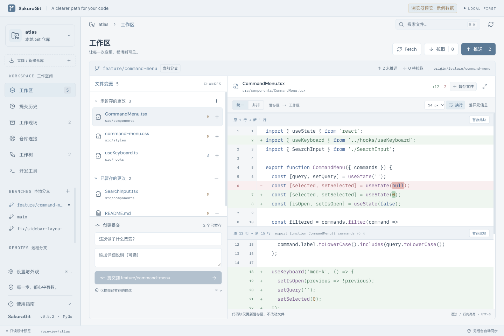
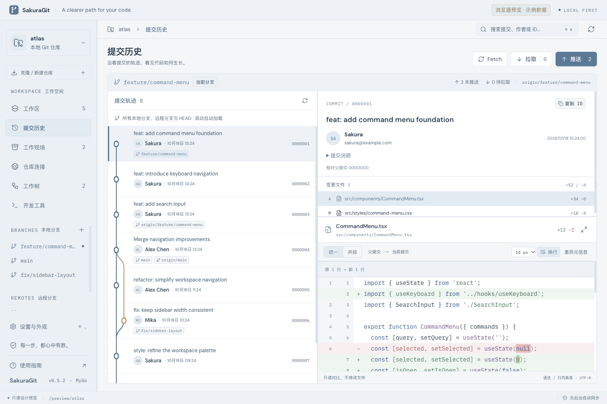

# SakuraGit

**让每一次 Git 变更，都清晰可见。**

[](https://github.com/yueseqaz/SakuraGit/actions/workflows/ci.yml) · [GitHub Releases](https://github.com/yueseqaz/SakuraGit/releases)

[English](README.en.md) · [技术验证记录](QA.md) · [MyGo](https://mygo.egoist.dev/)

SakuraGit 是一个使用 **MyGo + Go + React + TypeScript** 构建的轻量 Git 桌面客户端。它用系统 WebView 渲染界面，通过系统 Git 操作本地仓库，**不捆绑 Chromium**。雾霾蓝主题、可拖动面板和专注 Diff 阅读，让日常提交、代码审阅和分支操作更直观。

> 当前版本：**0.6.0，早期开发阶段**。已在 macOS Apple Silicon 上构建和测试，仍有明确的功能边界；不代表已完成生产环境或跨平台验证。目前界面以中文为主，英文文档不代表已实现英文界面。



## 功能一览

| 模块 | 已支持 |
| --- | --- |
| 仓库 | 打开本地仓库、最近仓库、初始化项目；克隆时选择分支，可选仅跟踪该分支 |
| 工作区 | 已暂存 / 未暂存分区、整文件和整组暂存 / 取消暂存；普通文本修改按块、按行暂存 / 取消暂存 |
| 提交 | 标题和详细说明；仅提交已暂存内容；按仓库保存提交草稿 |
| Diff | 统一 / 并排、语法与行内高亮、自动换行、字号调整、改动导航（F7 / Shift+F7）、全窗口专注阅读 |
| 历史 | 作者、邮箱、提交详情、变更文件与单文件 Diff；父提交关系图；滚动自动翻页与全历史搜索 |
| 分支 | 创建、切换、重命名、安全删除已合并分支、设置 upstream、检出远程分支、本地分支合并 |
| 同步 | Fetch、仅快进 Pull、非强制 Push、首次推送设置 upstream；执行前显示真实目标与确认 |
| Stash | 保存、查看、恢复和删除；可包含未跟踪文件、恢复暂存状态；恢复后保留原记录 |
| 开发工具 | 内置三方合并与逐块采用、外部编辑器 / 合并工具、检测残留冲突标记、继续 / 中止 Git 流程 |
| 内置终端 | MyGo + Ghostty 主窗口原生底部终端；多会话标签、仓库隔离、拖动高度、最大化 / 收起；交互式 Shell 和退出保护 |
| 撤销与恢复 | Soft Reset 撤销末次本地普通提交、单文件备份后恢复、备份恢复到工作区；历史中支持 Cherry-pick / Revert |
| 连接与身份 | 管理远程 Fetch / Push 地址、查看 Git / 认证相关配置、设置仓库级姓名和邮箱 |
| 阅读与布局 | 雾霾蓝 / 石墨灰 / 苔原绿 / 暖砂纸，浅色 / 深色 / 跟随系统，终端配色同步；可拖动面板、比例记忆、会话与草稿恢复 |
| 操作状态 | 克隆与同步进度、耗时、取消、中文错误指引，以及写操作期间的退出保护 |

支持继续 / 中止已由 Git 启动的 Merge、Rebase、Cherry-pick 和 Revert 流程；Git 按钮不接受任意 Shell 命令。双方修改的普通 UTF-8 文本可在工作区内三方合并；特殊冲突使用外部工具。手动命令使用下述内置终端。Worktree 目前支持查看和打开。



## 下载与跨平台构建

前往 [GitHub Releases](https://github.com/yueseqaz/SakuraGit/releases) 下载成功发布的版本；构建全程在 GitHub 托管 runner 上进行，不上传开发者本机二进制文件。

| 系统 | 架构与安装格式 |
| --- | --- |
| macOS | Intel + Apple Silicon 通用 `.dmg` |
| Windows | x64 / ARM64，分别提供 `setup.exe` |
| Linux | x64 / ARM64，分别提供 `.deb` 和 `.tar.gz` |

所有包均需系统 Git。Windows 需要 WebView2 Runtime；Linux 需要图形桌面、GTK 3 和 WebKitGTK 4.1，`.deb` 会声明依赖。macOS 仅 ad-hoc 签名、未公证，Windows 未做 Authenticode 签名，系统可能显示安全警告。**跨平台构建通过不等于所有系统、架构和图形交互均已实机验证**，Windows / Linux ARM64 使用同系统 x64 runner 交叉编译。下载后可使用附件 `SHA256SUMS` 核对文件。

## 内置终端

打开仓库后，点击右上角 **终端**、开发工具中的 **内置终端**，或按 **Ctrl/Cmd + 反引号**。终端在**同一个主窗口底部**展开，不新建页面或窗口。可拖动分隔线调高度、最大化 / 恢复，点击「新建终端」增加会话，所有仓库合计最多 8 个会话。

- 初始目录为打开的仓库；macOS / Linux 使用用户的登录 Shell，Windows 优先使用 PowerShell，找不到时回退到系统命令解释器。用户 Shell 启动配置仍可能改变目录或执行自己的脚本。
- 支持交互输入、ANSI 颜色、中文、窗口缩放、滚动和右键复制粘贴；使用 `Ctrl+C` 中断命令，按住 Cmd/Ctrl 滚轮调整字号。
- 关闭运行中的会话、关闭工作区或退出应用时，默认保留会话，确认后才挂断终端并等待进程结束。「收起」仅隐藏面板，不结束会话；切换仓库不混用终端，其他仓库的会话继续后台运行。Shell 自行退出后保留标签输出，可新建会话。已脱离终端的后台进程不保证被结束；不会自动回滚命令。
- **终端是可执行任意命令的真实 Shell，不受 Git 按钮的安全限制。** 应用不自动发送命令或执行仓库脚本；用户自己的 Shell 配置仍会正常执行。终端协议的剪贴板读写默认被禁止，手动复制粘贴正常。应用不保存终端内容，但 Shell 自身可能保存历史。
- 回到 Git 界面时，既有的本地状态轮询会检查仓库变化。终端与其他 Git 客户端同样可能并发修改仓库，执行写操作前请核对状态。

终端运行库随安装包分发，不需要安装 Ghostty。此版本最低需要 **macOS 13**、**Windows 10 1809**；Linux 的终端库需要 glibc 2.28+，主窗口仍需要 GTK 3 / WebKitGTK 4.1。中文显示需要 CJK 字体，`.deb` 自动声明 `fonts-noto-cjk` 依赖，压缩包用户需自行安装。不支持重启后的 PTY 会话恢复和 Shell 选择器。终端高度保存到本机；设置和确认对话框打开时，终端视图暂时让出空间，会话仍在运行。

## 三方合并与恢复

- 在工作区选择冲突文件，界面展示 **Base / Ours（索引阶段 2）/ Theirs（阶段 3）**，下方编辑最终结果。可逐块采用任意一侧或依次保留双方；不会替换掉 Git 已自动合并的其他内容。
- Rebase 时 Ours 是已经变基的目标，Theirs 是正在重放的提交，不应简单理解为“本地 / 远程”。
- 保存前必须移除全部冲突标记。应用校验源文件、冲突索引与仓库版本，备份原文件，再写入并暂存；**不会自动继续流程或创建合并提交**。
- 内置合并限双方修改的普通 UTF-8 文本，每个版本不超过 1 MB。新增 / 删除冲突、二进制、符号链接、类型变化和子模块请使用外部工具。
- 未保存的合并结果按仓库和文件即时缓存到本机。检测到源版本变化时保留草稿，但禁止覆盖，须先复制需要保留的内容再重新读取；存储失败会明确提示。
- 「撤销与恢复」中，撤销末次提交使用 Soft Reset，保留工作区与暂存区；拒绝本地已知远程引用已包含的提交。远程状态以最近一次 Fetch 为准，未 Fetch 的远程推送无法被本地判断。
- 单文件恢复将未暂存修改恢复为暂存区版本，操作前备份；备份恢复只写工作区，不改暂存区。备份保存在各工作树的 Git 元数据目录 `sakuragit-backups/`，不上传、不自动清理；它不是完整仓库备份或操作记录。
- 历史详情提供 Cherry-pick 和 Revert，要求工作区干净，保留 hooks 和签名检查；合并提交需要指定主线，请在终端操作。

## 快速开始

### 环境要求

- **Git**：安装在系统中，桌面应用需要能找到它。
- **Go 1.27.1+**：版本由 `go.mod` 声明；Go 可按配置自动下载所需工具链。
- **Node.js 22.12+** 与 npm。
- 构建目标所需的系统开发工具；macOS 请安装 Xcode Command Line Tools。

| 平台 | 验证状态 |
| --- | --- |
| macOS Apple Silicon / ARM64 | 本地界面与原生冒烟已验证；Actions 提供通用包 |
| macOS Intel、Windows、Linux | Actions 构建目标；图形界面和所有目标设备尚未完整实测 |

### 本地开发

```sh
git clone https://github.com/yueseqaz/SakuraGit.git
cd SakuraGit
npm ci
npm run dev
```

`npm run dev` 启动 MyGo 桌面窗口和 `http://127.0.0.1:5274` 上的 Vite 服务。使用 npm 和 JSON 配置，不需要 Bun。

只预览界面：

```sh
npm run dev:web
```

**浏览器预览使用明确标注的只读示例数据**，不能访问本地仓库，不会假装 Git 操作成功。真实 Git 操作只在 MyGo 桌面窗口中提供。字体和语法高亮随应用打包，不依赖运行时 CDN。

### 构建桌面应用

```sh
npm run build
```

在 macOS ARM64 上输出：

```text
build/darwin-arm64/SakuraGit.app
build/darwin-arm64/SakuraGit 0.6.0 arm64.dmg
```

```sh
open build/darwin-arm64/SakuraGit.app

# 启动并打开指定仓库
build/darwin-arm64/SakuraGit.app/Contents/MacOS/SakuraGit --repo /absolute/path/to/repository
```

目前本机构建使用 **ad-hoc 签名，未经过 Apple Developer ID 签名或公证**。预编译包通过 GitHub Release 工作流提供；请只运行你信任并自行验证的构建。

## 使用提示

- **调整面板**：拖动区块之间的分隔线；双击恢复该处默认比例。聚焦分隔线后用方向键微调，Shift 加大步长，Esc 取消当前拖动。比例保存在本机；窄窗口改为堆叠布局。
- **阅读历史**：每批 100 条，接近底部自动加载，超过 300 条时使用虚拟列表。搜索说明、作者、邮箱或提交 ID 会搜索整个本地可达历史，不限首屏。
- **外观设置**：左下角「设置与外观」，或 `Cmd/Ctrl + ,`。Diff 支持 11–16 px 字号与 Esc 退出专注阅读。
- **同步与认证**：复用系统 Git 的 SSH、凭据助手和签名配置；如需交互式认证，请先在终端完成。软件不保存账号密码，也不接受 URL 内嵌凭据。
- **本地状态**：按仓库保存草稿、恢复上次页面和文件选择。为兼容旧名 Gitlane，保留原应用标识、`Gitlane` 用户数据目录和 `gitlane.*` 本机缓存键；不是把个人配置写入源码仓库。

## 安全边界与已知限制

- Git 按钮不提供强推、硬重置或任意 Shell 命令；受限的单文件恢复需要确认并先保存备份。内置终端则是真实、不受此限制的 Shell。分支切换和 Stash 恢复要求工作区干净；Pull 只允许快进，不会自动 Stash、Merge 或 Rebase。
- 取消不等于回滚：提交、上传或部分文件操作可能已经发生。取消或失败后请刷新确认实际状态；克隆目录保留供检查，不自动删除。
- Git hooks、签名和外部合并工具沿用本机配置，可能执行本地程序。**只打开可信仓库**；应用内的版本校验不能阻止其他 Git 客户端并发写入。
- 分块与按行暂存仅支持普通已跟踪文本修改；新增、删除、重命名、二进制、符号链接、模式变化和子模块等使用整文件操作。按行选择新增行和删除行是独立的，若要暂存一次替换，请同时选择相应的删除与新增行。
- Diff 不调用外部 Diff / textconv；界面最多显示 3,000 行，并明确提示超限。高亮基于补丁上下文尽力解析，大型或未知语言内容会降级为纯文本。
- 历史仅包含本地可达提交，不会自动 Fetch。浅克隆的历史深度仍受仓库限制。普通 Git 命令通常限时 90 秒，克隆为 30 分钟。
- 暂无交互式 Rebase、标签管理、创建 / 删除 Worktree，以及子模块 / LFS 完整管理。现有子模块 / LFS 检测只是提示。
- 大型真实生产仓库、在线 GitHub / GitLab 认证、完整进程崩溃恢复和跨平台运行仍需进一步验证。会话缓存不是文件备份。

## 测试

```sh
npm test          # Go race 检测 + 前端测试
npm run build:web
go vet ./...
```

前端单元测试和浏览器 fixture 测试，以及覆盖 Git 状态、提交、同步、分页、冲突流程、取消、会话和路径保护的 Go 集成测试。测试使用自建临时仓库与本地裸远程，不访问你的私有仓库。CI 还渲染三平台原生终端，并用 Chromium fixture 检查四款主题、深浅模式、三方合并和窄屏布局。浏览器 fixture 的 IPC 是模拟数据，不等同真实桌面端到端验证。

原生测试会创建并修改独立测试仓库，启动打包后的桌面应用：

```sh
scripts/native-smoke.sh

# 无法保证窗口始终可见的自动化环境：显式跳过自动轮询及后续推送确认
scripts/native-smoke.sh build/darwin-arm64/SakuraGit.app/Contents/MacOS/SakuraGit --skip-auto-refresh
```

该脚本验证 426 条历史的自动滚动加载、最早提交详情、全历史搜索、打包后的高亮 Worker、桌面刷新保护，以及纯本地克隆等。日志与临时仓库路径记录在 `build/`，测试仓库保留供检查。跳过的项目不计为通过。详细覆盖范围和未验证事项见 [QA.md](QA.md)。

## GitHub Actions 与发布

- `CI`：推送 `main`、提交 Pull Request 或手动触发时，在 macOS / Windows / Linux 上运行前端测试、前端构建、Go race 测试和 `go vet`，通过后构建五组平台产物。普通 CI 的安装包可在该运行的 Artifacts 下载，保留 14 天。
- `Release`：推送 `v*` 标签，或手动选择一个已有标签；版本必须与 `package.json`、lockfile、`mygo.json`、Go 和界面的版本一致，并存在 `docs/releases/<tag>.md`。
- 所有平台通过后，收集七个安装包，验证 Windows / Linux 主程序架构、macOS 通用架构与签名，并生成 `SHA256SUMS`。先上传到草稿，再公开，避免半成品 Release。
- 标签触发默认发布为早期预览；手动发布可选择是否为 prerelease。不覆盖已经公开的 Release。Actions 使用内置 `GITHUB_TOKEN`，不需要添加个人 Token；只在最终发布 job 授予仓库写权限。

发布新版本时，更新版本号和发布说明，先确认 `main` 的 CI 通过，再执行：

```sh
git tag v0.6.0  # 示例：替换为对应的新版本号
git push origin v0.6.0
```

工作流见 [CI](.github/workflows/ci.yml)、[跨平台构建](.github/workflows/build.yml) 和 [Release](.github/workflows/release.yml)。尚未配置应用内自动更新、Apple 公证或 Windows 签名证书。

## 项目结构

```text
main.go / *_api.go         MyGo 窗口、原生 API 与类型化 IPC
internal/gitrepo/          Git 命令、状态解析、操作保护与集成测试
operations.go             操作进度、取消、串行化与退出保护
session.go                会话与草稿的原子持久化
src/App.tsx               工作区、导航与交互
src/DiffPanel.tsx          Diff 阅读器
src/HistoryPanel.tsx      自动分页历史与虚拟列表
src/ResizableSplit.tsx    可保存的面板分隔布局
src/WorkflowPanel.tsx     冲突、分支和外部开发工具
src/mygo.ts               自动生成的 TypeScript IPC 客户端
src/demo.ts               只读浏览器示例数据
scripts/native-smoke.sh   独立本地仓库的原生冒烟测试
```

## 反馈与许可

欢迎通过 [Issues](https://github.com/yueseqaz/SakuraGit/issues) 提交问题。请说明系统、版本、复现步骤和已脱敏的错误信息，**不要上传 Token、私钥或私有仓库内容**。

本项目暂未指定开源许可证；公开可见不等于已授予任意使用、修改或再分发许可。依赖与字体的许可分别归其各自作者所有。
